# Proyecto 1 · Mi web en AWS

**Cristian Moresi Nadal · 2.º DAW · Introducción a la Nube Pública**  
AWS Academy Learner Lab · `us-east-1` · 11/11/2026

## B1. La red

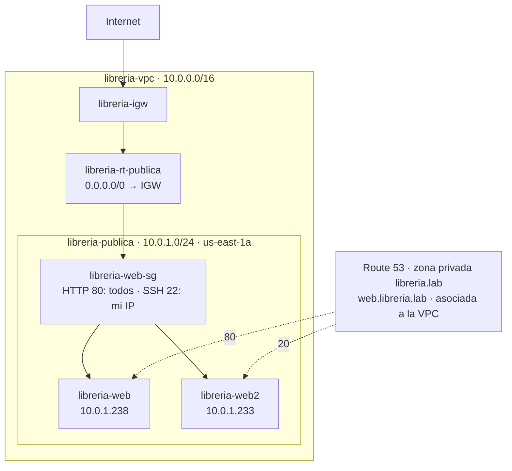

La subred es pública porque su tabla tiene una ruta `0.0.0.0/0` hacia la puerta de enlace de internet. La asignación automática de IPv4 pública está activada.

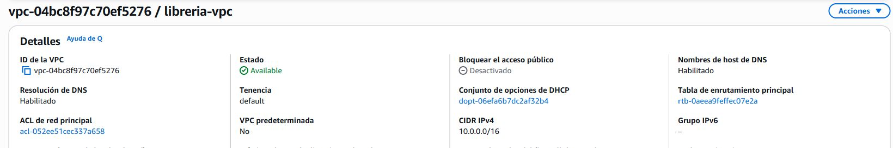
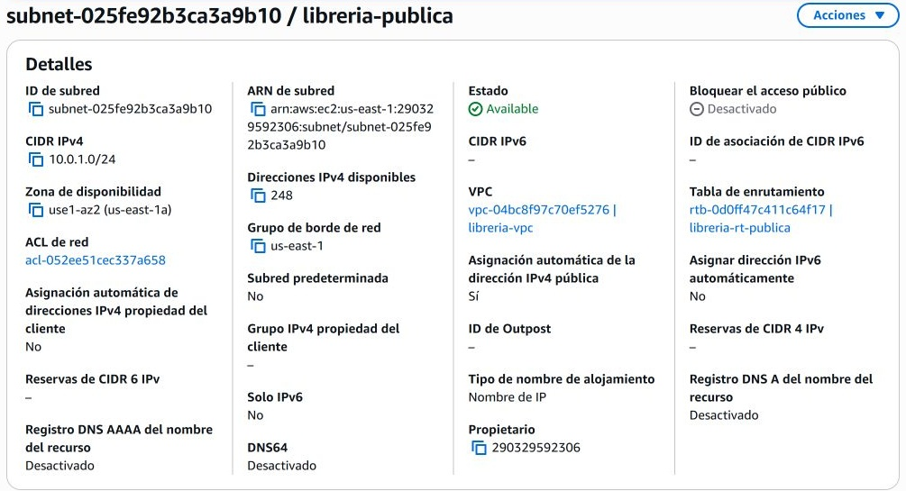
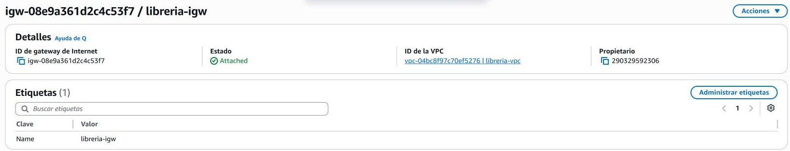
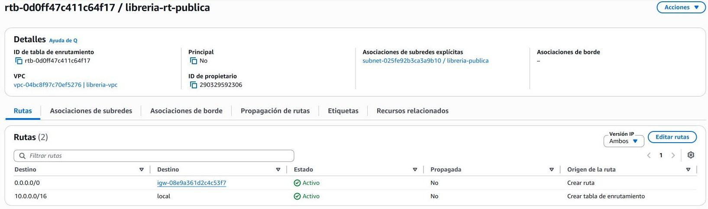

## B2. La seguridad

`libreria-web-sg`, dentro de `libreria-vpc`: HTTP/TCP 80 desde `0.0.0.0/0` y SSH/TCP 22 desde **Mi IP (/32)**. La web es accesible para todos; la administración por SSH queda limitada a mi conexión.

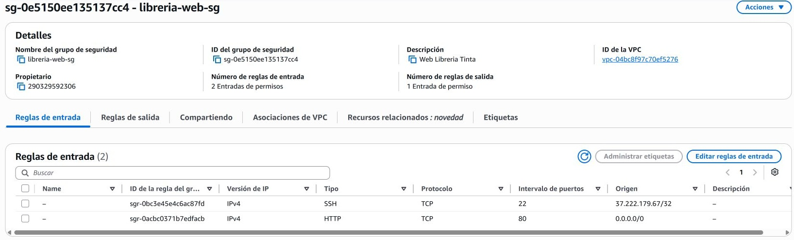

## B3. El servidor web

`libreria-web`: Amazon Linux 2023, `t3.micro`, disco gp3 de 8 GiB y clave `vockey`. Subred `libreria-publica` y grupo `libreria-web-sg`. Etiquetas: `Proyecto=P1` y `Alumno=Cristian Moresi`.

El [script de arranque](scripts/user-data1.sh) instala nginx y publica el horario, la dirección ficticia y una recomendación de lectura. El pie muestra el servidor y la fecha del despliegue.

IP privada: `10.0.1.238`. IP pública: `44.207.2.143`.

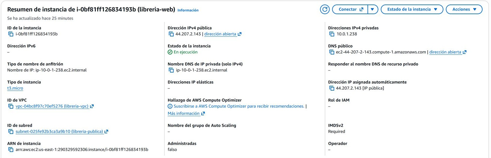
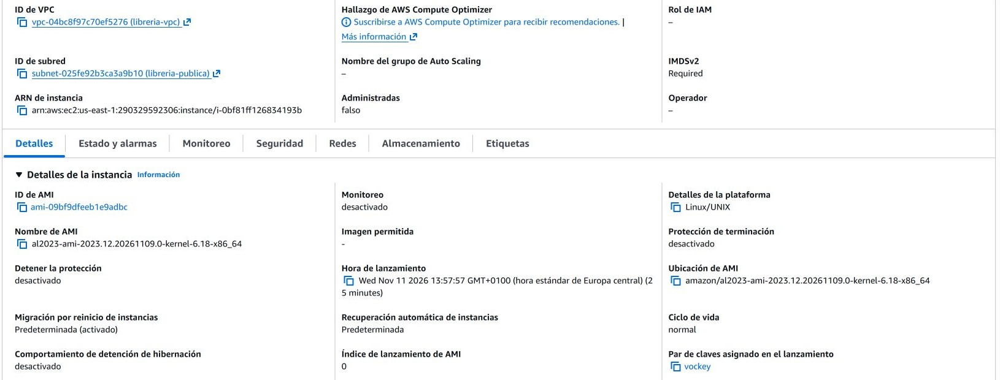
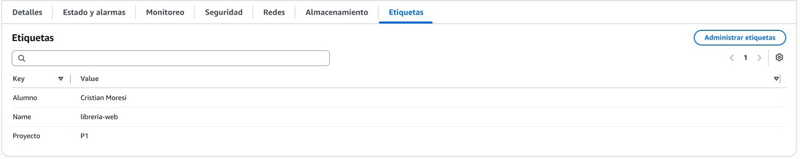
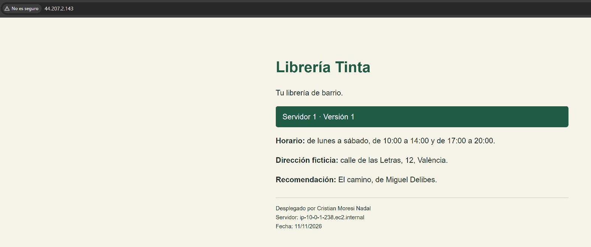

Conexión SSH comprobada con `ec2-user`: nombre de host `ip-10-0-1-238.ec2.internal` y servicio nginx en estado `active`.

## B4. Cálculo de costes

**11,88 USD/mes**: servidor y disco, 8,23 USD; IPv4 pública, 3,65 USD. [Estimación compartida](https://calculator.aws/#/estimate?id=fa3d0dd691372aa7eb2a69a126c69aff303eabc7).

Condiciones: `us-east-1`, Linux, bajo demanda, 24/7 (730 h/mes), gp3 de 8 GB, sin tráfico de pago adicional ni impuestos. Detener el servidor fuera del horario necesario reduciría el coste de computación.

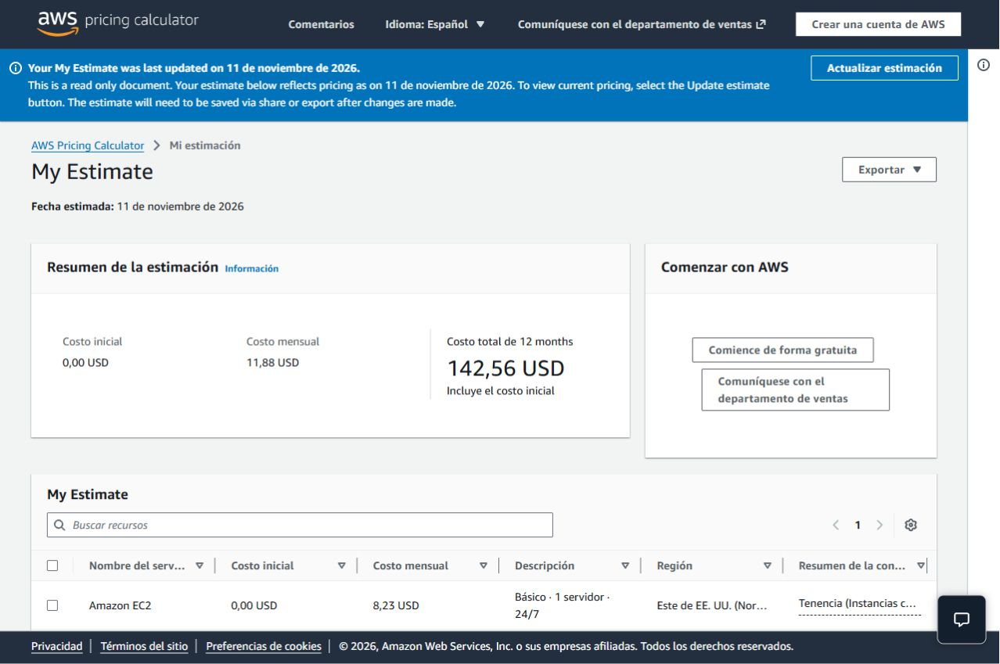

## B5. Documentación

[Vídeo del proyecto](https://youtu.be/Xt7CcFOa-uE).

## M1. DNS

`libreria-web2` usa la misma red y seguridad, con [user-data2.sh](scripts/user-data2.sh) y una página morada reconocible como versión 2. IP pública: `54.175.120.167`.

Zona **privada** `libreria.lab`, asociada a `libreria-vpc`, con resolución DNS y nombres de host DNS activados.

| Nombre y tipo | Identificador | Peso | IP privada | TTL |
| --- | --- | ---: | --- | ---: |
| `web.libreria.lab` · A | servidor1 | 80 | `10.0.1.238` | 0 |
| `web.libreria.lab` · A | servidor2 | 20 | `10.0.1.233` | 0 |

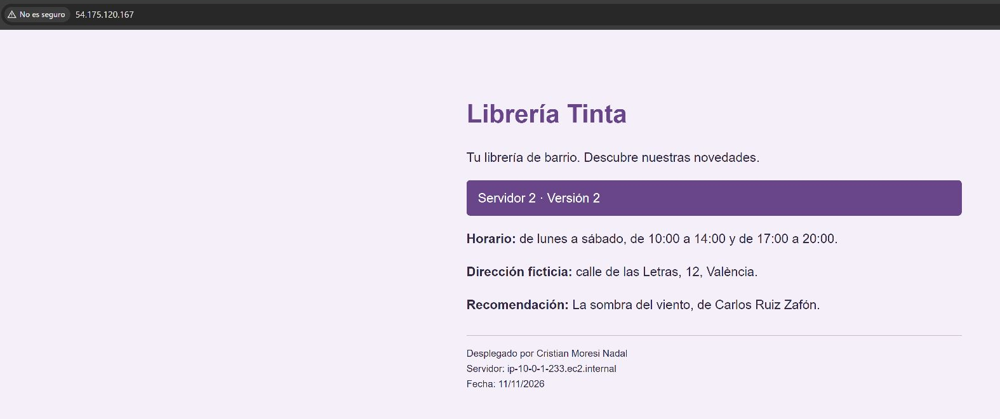
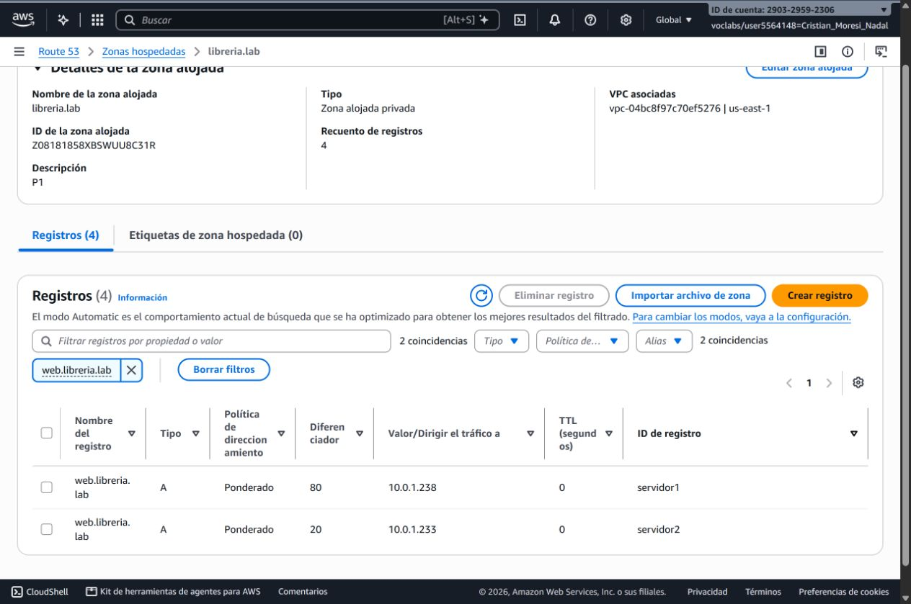

Prueba desde SSH en `libreria-web`, dentro de la VPC:

```text
ip-10-0-1-238.ec2.internal
web.libreria.lab.  0  IN  A  10.0.1.238
```

En 20 peticiones con `curl`, **17** respuestas fueron de la versión 1 y **3** de la versión 2. Los pesos son probabilidades, por lo que cada muestra puede variar. El nombre privado solo se resuelve dentro de la VPC; TTL 0 evita conservar una respuesta durante las pruebas.

## M2. Actualización del coste del proyecto

**24,26 USD/mes**, con las mismas condiciones de B4: dos servidores y discos, 16,46 USD; dos IPv4 públicas, 7,30 USD; zona DNS privada, 0,50 USD. [Estimación compartida](https://calculator.aws/#/estimate?id=1b53b167dfd29bc68a35e48c35e9f7dc367ca19f).

Las consultas a zonas privadas no tienen cargo adicional ([tarifas de Route 53](https://aws.amazon.com/route53/pricing/)).

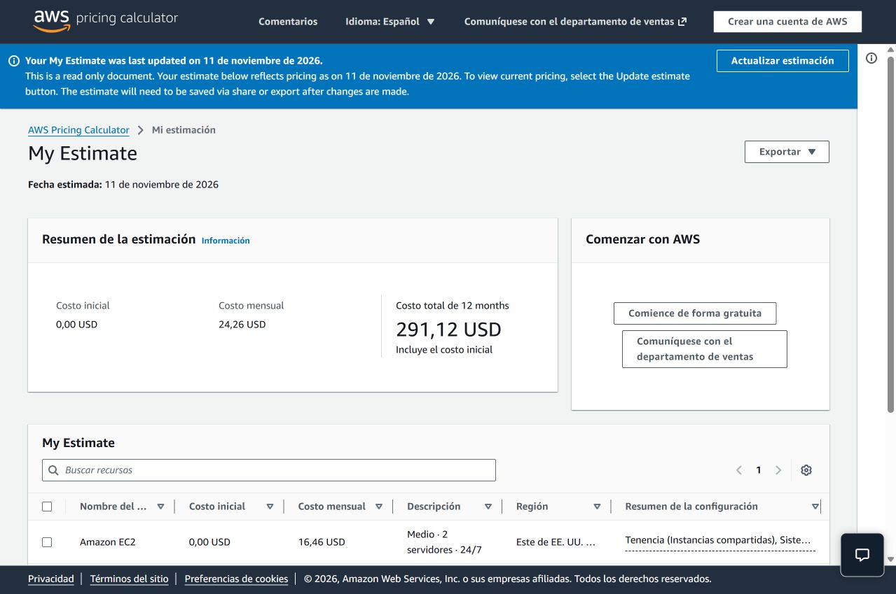

## Nivel avanzado

[desplegar.sh](scripts/desplegar.sh) reutiliza la red y automatiza B2 y B3: obtiene Amazon Linux 2023, crea `libreria-web-cli-sg`, permite HTTP y limita SSH a mi IP. Lanza `libreria-web-cli`, espera al estado `running` y muestra su URL.

Ejecución completada sin errores y web accesible tras la instalación de nginx.

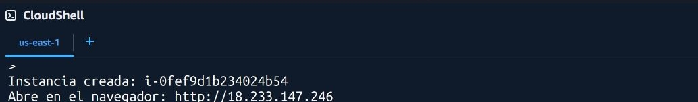

## Uso de IA

**ChatGPT/Codex** como apoyo para entender requisitos, preparar scripts, revisar la documentación y preparar el repositorio en GitHub.

Prompts resumidos:

- Requisitos y configuración de AWS.
- Scripts y comprobaciones.

Error: la IP obtenida en CloudShell correspondía al entorno remoto. La regla SSH se corrigió con mi IP pública y se verificó en AWS.
